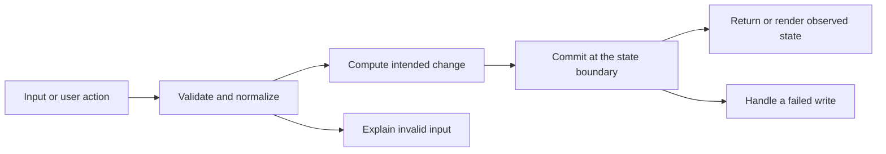

# Codebase map and reading order

[Course index](README.md)

## The problem this project solves

Import validation checked only a few outer fields; malformed scheduler values/settings or duplicate card IDs could enter a restore. Unknown-card logs were retained. One existing learning snippet exceeded its tested mobile length limit. The improvement you will study is: A complete import validator runs before the replacement transaction. It checks state/log/settings/meta values and unique card IDs; unknown-card states and logs are omitted consistently, missing known states are recreated, and rejected imports preserve progress. The long worked snippet was shortened without changing its behavior.

## Data model

Bundled cards and decks provide learning content. ReviewState tracks cardId, ease, intervalDays, due, status, learningStepIndex, lapses and reps. ReviewLog records a grade/time. Settings and Meta hold study limits and streaks. Dexie wraps IndexedDB transactions.

An object is a named collection of fields. An array is an ordered collection of values. An id answers “which record?”; an index answers “where is it in this array right now?” Those questions are different whenever the list can be filtered, reordered or edited. Persisted data is the form that must survive a process/page restart. Derived data can be recomputed from that persisted state.

## Trace one action

1. The Settings UI reads an uploaded JSON backup.
2. JSON parsing yields unknown runtime values.
3. The import validator checks nested records, identity and numeric/date constraints.
4. A valid result reaches the existing replacement operation.
5. The storage layer writes the accepted candidate according to its documented boundary.
6. The UI reloads or renders the saved result and reports rejected input.

This diagram names responsibilities, not necessarily separate files. A small browser program can keep them in app.js. A larger API spreads them across controllers, services and models. Follow the actual sequence above rather than assuming every repository has the same architecture.

## Where to read first

1. [src/db.ts](../src/db.ts): locate `importData` and read its inputs, branches and return/side effects.
2. [src/importValidation.test.ts](../src/importValidation.test.ts): read the scenario names before the helper code.
3. The root [README](../README.md): connect setup and the larger application workflow.

## Source navigation

- [src/App.tsx](../src/App.tsx)
- [src/app.integration.test.ts](../src/app.integration.test.ts)
- [src/components/CardView.tsx](../src/components/CardView.tsx)
- [src/components/CodeBlock.tsx](../src/components/CodeBlock.tsx)
- [src/components/GradeBar.tsx](../src/components/GradeBar.tsx)
- [src/components/RichText.tsx](../src/components/RichText.tsx)
- [src/content/code-quality.ts](../src/content/code-quality.ts)
- [src/content/css-fundamentals.ts](../src/content/css-fundamentals.ts)
- [src/content/debugging-and-errors.ts](../src/content/debugging-and-errors.ts)
- [src/content/dsa-patterns.ts](../src/content/dsa-patterns.ts)
- [src/content/index.ts](../src/content/index.ts)
- [src/content/js-async.ts](../src/content/js-async.ts)
- [src/content/js-fundamentals.ts](../src/content/js-fundamentals.ts)
- [src/content/react-mental-model.ts](../src/content/react-mental-model.ts)
- [src/content/security-basics.ts](../src/content/security-basics.ts)
- [src/content/tooling.ts](../src/content/tooling.ts)
- [src/content/ts-essentials.ts](../src/content/ts-essentials.ts)
- [src/content/web-and-systems.ts](../src/content/web-and-systems.ts)
- [src/db.ts](../src/db.ts)
- [src/importValidation.test.ts](../src/importValidation.test.ts)
- [src/importValidation.ts](../src/importValidation.ts)
- [src/main.tsx](../src/main.tsx)
- [src/queue.test.ts](../src/queue.test.ts)
- [src/queue.ts](../src/queue.ts)
- [src/scheduler.test.ts](../src/scheduler.test.ts)
- [src/scheduler.ts](../src/scheduler.ts)
- [src/screens/Home.tsx](../src/screens/Home.tsx)
- [src/screens/Session.tsx](../src/screens/Session.tsx)
- [src/screens/Settings.tsx](../src/screens/Settings.tsx)
- [src/screens/Stats.tsx](../src/screens/Stats.tsx)
- [src/screens/Summary.tsx](../src/screens/Summary.tsx)
- [src/store.ts](../src/store.ts)
- [src/types.ts](../src/types.ts)
- [vite.config.ts](../vite.config.ts)

## A practical reading technique

At each function boundary, write down the value coming in, the value going out and any side effect. A side effect includes a storage write, SQL query, network request, timer registration or DOM update. If a function calls another function, inspect only that next dependency until you can finish the chosen trace. Return to unrelated files later.

For this lesson, start with: **Export fresh progress, set one card reps to 7 and restore only that state: the card keeps 7 reps and missing cards receive new states. Include one unknown-card log: it is omitted. A negative due value, duplicate state ID, invalid study limit or impossible metadata date rejects before any stored progress changes.** Mark where the id, time, amount or other important value changes representation. For example, JSON serializes values into text; a date field may be a calendar string; SQL aggregates may return a different type from individual rows. Representation changes are common bug locations.

## Check your understanding

Without reading the solution, answer: Who owns the mutable state? Which input is untrusted? Which function first decides whether the operation is valid? What survives reload or restart? What observation would prove that the operation partially failed? Point to a source file for each answer, rather than describing a generic app from memory.
