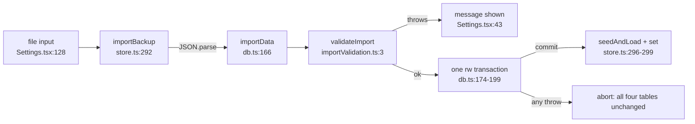

# Codebase map and the import trace

[Course index](README.md)

## The problem this course is about

A backup is a JSON file a user can edit, truncate, or carry over from an older build. An earlier version of the import checked only a few outer fields, so out-of-range scheduler values, malformed settings or duplicate card ids could be restored, and logs for cards that no longer exist were kept. Now `importData` calls `validateImport`, which checks every state, log, setting and metadata field before the replacement transaction opens.

## How the repository is laid out

| Path | What lives there | Read for this course? |
|---|---|---|
| `src/types.ts` | `Card`, `ReviewState`, `ReviewLog`, `Settings`, `Meta`, `ExportData`, `SCHEMA_VERSION`, `ALL_CARD_TYPES` | Yes, first |
| `src/db.ts` | Dexie schema, seeding, `saveReview`, `buildExport`, `importData`, `resetProgress` | Yes |
| `src/importValidation.ts` | `validateImport`, the runtime check for a backup | Yes |
| `src/store.ts` | Zustand store: sessions, grading, streaks, `exportBackup`, `importBackup` | Only `importBackup` |
| `src/scheduler.ts`, `src/queue.ts` | Pure SM-2 scheduling and session-queue building | Only to understand field ranges |
| `src/screens/Settings.tsx` | Export, import, reset, study limits | Yes, the import handler |
| `src/content/*.ts` | 265 cards in 11 deck files, assembled in `content/index.ts` | No |
| `src/*.test.ts` | Four Vitest files, run in Node with `fake-indexeddb` | Yes |

## The data a backup contains

`ExportData` (`src/types.ts:117-124`) has six fields: `schemaVersion`, `exportedAt` (milliseconds), `reviewStates`, `reviewLogs`, `settings` and `meta`. It does **not** contain cards or decks; those ship with the app. So a backup is "progress against cards this build knows about", and an import has to decide what to do with progress for cards that no longer exist.

- `ReviewState` (`types.ts:68-77`): one per card, keyed by `cardId`. `ease`, `intervalDays`, `due` (ms timestamp), `status` (`new | learning | review | relearning`), `learningStepIndex`, `lapses`, `reps`.
- `ReviewLog` (`types.ts:79-86`): one per graded review. `id` is an auto-increment key Dexie assigns.
- `Settings` (`types.ts:88-94`): `newCardsPerDay`, `maxReviewsPerDay`, enabled card types and deck ids, theme.
- `Meta` (`types.ts:96-107`): streaks, the last review day, and the "new cards introduced today" counter. Days are local `YYYY-MM-DD` strings.

## Where it is stored

[src/db.ts](../src/db.ts) lines 19-38 define one IndexedDB database, `devdeck`, with six tables: `cards`, `decks`, `reviewStates` (primary key `cardId`), `reviewLogs` (`++id`), `settings` and `meta` (one row each, keyed `'settings'` and `'meta'`). Unlike `localStorage`, IndexedDB has transactions that can span several tables. That is the property the import relies on.

## Trace one import, file by file

1. **The file input.** `Settings.tsx:128-137`: a hidden `<input type="file" accept="application/json">`. `onChange` calls `onImportFile(file)` and clears `e.target.value` so the same file can be picked twice.
2. **Hand-off to the store.** `onImportFile` (`Settings.tsx:38-45`) calls `importBackup(file)` and shows either the returned message or the thrown error's `message`.
3. **Parse.** `importBackup` (`src/store.ts:292-301`) reads `file.text()` and does `JSON.parse(text) as ExportData` (line 294). The cast checks nothing; a non-JSON file throws a `SyntaxError` here, and its raw message is what the user sees.
4. **Validate.** `importData` (`src/db.ts:166`) first calls `validateImport(payload)` (line 170). That function throws `Error('Malformed backup: <part>')` at the first problem. No transaction has started yet.
5. **Filter.** Lines 171-172 keep only states whose `cardId` is a card in this build.
6. **Replace, atomically.** Lines 174-199: one `db.transaction("rw", [reviewStates, reviewLogs, settings, meta], ...)`. Inside it: clear states, add the kept states, create fresh states for any bundled card the backup did not cover, clear logs, add the logs for known cards (without their old `id`), overwrite settings and meta. If anything inside throws, Dexie aborts the transaction and IndexedDB rolls back every table it touched, including the `clear()`.
7. **Republish.** Back in `importBackup`, `seedAndLoad` re-reads the database (line 296) and `set({ states, settings, meta })` (line 299) updates React. The UI shows what was committed, not the parsed file.
8. **Report.** The message is `Restored progress for N cards.`, where `N` is `importData`'s return value: the number of states kept after filtering.

The export side is `exportBackup` (`store.ts:279-290`) → `buildExport` (`db.ts:140-160`), which reads the four progress tables and adds `schemaVersion` and `exportedAt`.

## Reading order

1. `src/types.ts` lines 68-126.
2. `src/importValidation.ts` (87 lines): the helpers on lines 6-23 first, then each block.
3. `src/db.ts` lines 140-201: `buildExport` and `importData`.
4. `src/store.ts` lines 279-301.
5. `src/importValidation.test.ts` (80 lines), reading the `it(...)` names first.

## Check your understanding

1. Which function first decides that an import is invalid, and how does it signal that: a return value or an exception?
2. If the backup contains a state for a card that was removed from the app, what happens to it, and to that card's logs?
3. A backup covers 3 cards. How many review states exist after import, and why?
4. Which line would you point to as "the reason a failed import cannot half-apply"?
5. What does the user see for a file that is not JSON at all?
